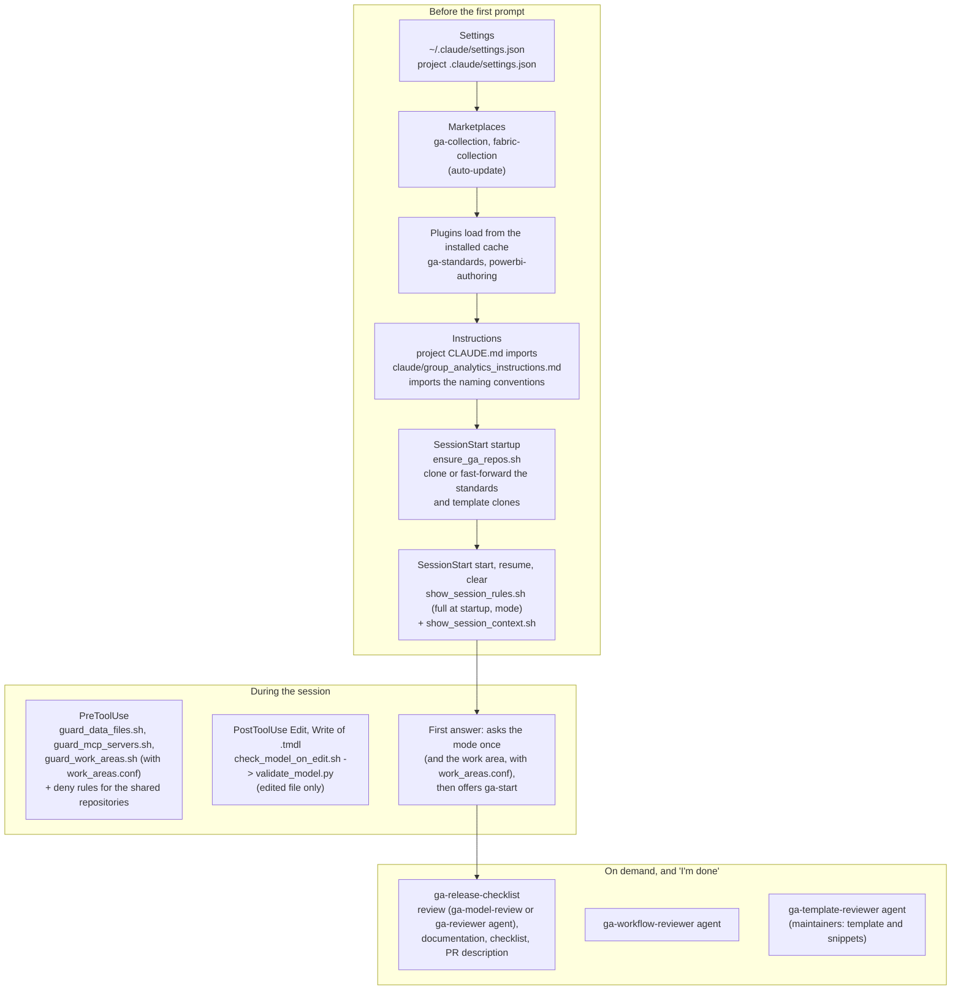
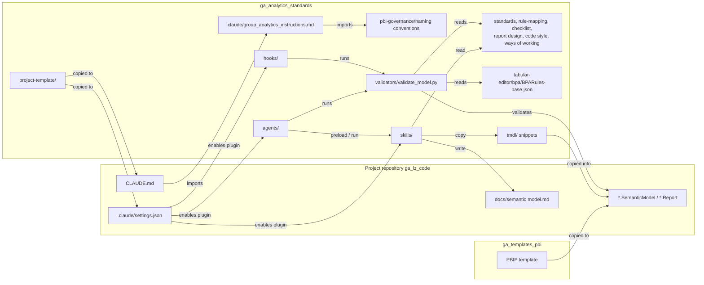

# Setup lineage

How the Group Analytics Claude Code setup connects: what happens when a session starts in a
project repository (`ga_<lz_code>`), and which files in this repository, the template
repository and the project lead to which. One line per file says what it is for.

Update this file when a skill, agent, hook or governance file is added, moved or removed.

## In short: step by step

What a developer needs at each step, and what the setup does for them.

| Step | You need | The setup does |
|---|---|---|
| 1. Install | VS Code with Claude Code, the Claude Code CLI, Git (Git Bash on Windows), GitHub CLI signed in to Vitrolife GHE, Python 3.8+, Power BI Desktop with the PBIP, TMDL and PBIR preview features | - |
| 2. Get access | Claude in the Vitrolife organization; GHE `group-analytics` (write on your landing zone repository, read on the shared ones); Atlassian connector; SharePoint Infiles lists; the landing zone's DEV workspaces. Ask your manager, ticket to servicedesk@vitrolifegroup.com | - |
| 3. Repository | A landing zone repository `ga_<lz_code>` with the files from `project-template/`, next to the other Group Analytics repositories in one folder | Settings: the two plugins, Ask before edits as start mode, auto and bypass off, no edits to the shared repositories. `CLAUDE.md` loads the shared instructions |
| 4. Open a session | Open the folder in VS Code; the first time, accept the plugins | Updates the standards and template clones, shows the Vitrolife AI rules and where you are, asks the mode, blocks data files and the Power BI and Fabric MCP servers |
| 5. Start a ticket | A Jira ticket | `ga-start` reads the ticket, creates the feature branch and, for a new model or report, copies the PBIP template |
| 6. Build | Describe the task | Skills for naming, standard components, measures and report pages; a model check after every model edit |
| 7. Finish | Say "I'm done" | Review with a proposed fix per finding, data product documentation, release checklist, pull request description |
| 8. Pull request | A Group Analytics reviewer | Reviewer gets the review result and the decisions to make; merge to `main` |
| 9. Publish | The landing zone's service account and workspaces | Manual from Power BI Desktop until the repository has workflows ([getting-started.md](getting-started.md#after-merge)) |

## Session start

## How the parts connect

## Files and their tasks

### Your machine

| File | Task |
|---|---|
| `~/.claude/settings.json` | User settings. Knows the fabric-collection marketplace; plugins are enabled per project. |
| `~/.claude/plugins/installed_plugins.json` | Which plugin versions are installed for which project. |
| `~/.claude/plugins/cache/ga-collection/ga-standards/<version>/` | The installed plugin copy that skills, agents and hooks run from (`${CLAUDE_PLUGIN_ROOT}`). |
| `~/.claude/plugins/marketplaces/ga-collection/` | Local clone of the marketplace, auto-updated in the background. |

### Project repository (`ga_<lz_code>`)

| File | Task | Comes from or leads to |
|---|---|---|
| `CLAUDE.md` | Imports the shared instructions; states the repository facts. | From `project-template/`; imports `claude/group_analytics_instructions.md` |
| `.claude/settings.json` | Starts in Ask before edits (auto and bypass off); pre-approves read-only git and gh commands (effective for the Bash tool; the VS Code extension ignores the PowerShell rules) and reading the shared repositories; denies edits to them; adds the two marketplaces and enables both plugins. | From `project-template/` |
| `.claude/work_areas.conf` | Work areas (Engineering, Data models, Reports), their folders and the folders each one blocks. Delete it to switch the work area guard off. | From `project-template/`; read by `guard_work_areas.sh` |
| `.github/pull_request_template.md` | The pull request description: ticket, finishing steps, exceptions, business validation. | From `project-template/`; filled by `ga-release-checklist` |
| `docs/quick-guide.md` | One page: the flow and what to type; links to the prerequisites in `docs/getting-started.md`. | From `project-template/` |
| `.gitignore` | Keeps the Desktop cache and local settings out of git. | From `project-template/` |
| `.gitattributes` | Stores text files with LF line endings, so Desktop saves (CRLF on Windows) do not rewrite every line; shell scripts always LF. | From `project-template/` |
| `README.md` | How to start in the repository. | From `project-template/`; links `docs/quick-guide.md` |
| `<model>.pbip`, `*.SemanticModel/`, `*.Report/` | The model (TMDL) and report (PBIR). | From the PBIP template and the `tmdl/` snippets; checked by `validate_model.py` |
| `docs/<semantic model name>.md` | Data product documentation, incl. exceptions. | Written by `ga-data-product-documentation` from `docs/templates/` |

### ga_analytics_standards: plugin

| File | Task | Leads to |
|---|---|---|
| `.claude-plugin/marketplace.json` | Defines the ga-collection marketplace: one plugin, sourced from this repository. | `plugin.json` |
| `.claude-plugin/plugin.json` | Plugin name and version; a higher version makes installs update. | `skills/`, `agents/`, `hooks/` |
| `hooks/hooks.json` | Registers the hooks for session start, before tools and after edits. | The hook scripts |
| `hooks/ensure_ga_repos.sh` | At startup: clones or fast-forwards the standards and template clones; says when a newer plugin is out (Claude Code updates it in the background; `/reload-plugins` loads it, manual commands are the fallback). | GHE remotes, `plugin.json` |
| `hooks/show_session_rules.sh` | Shows the Vitrolife AI rules (in full at startup, short on resume) and the mode; at startup Claude asks once which mode the developer wants; warns in auto or bypass mode. Acts wherever the plugin is enabled. | `claude/session_rules.md` |
| `hooks/show_session_context.sh` | Shows repository, branch, ticket, changes and plugin version; points to ga-start. | `ga-start` |
| `hooks/guard_data_files.sh` | Blocks reading data files such as `.abf`, `.csv` and `.xlsx`. | |
| `hooks/guard_mcp_servers.sh` | Blocks Power BI and Fabric MCP tools during the pilot. Acts wherever the plugin is enabled. | |
| `hooks/guard_work_areas.sh` | Only with `.claude/work_areas.conf`: at start Claude asks the work area; the developer's answer (or typing `work area: <name>`) is stored outside the repository; edits and writing shell commands in the folders blocked for that work area are stopped. | `.claude/work_areas.conf` |
| `hooks/check_model_on_edit.sh` | After a `.tmdl` edit: runs the model check and reports findings in the edited file; a warning only. | `validate_model.py` |
| `validators/validate_model.py` | Checks TMDL against the BPA rules, naming and some standards; Python, no installation. | `BPARules-base.json`, `standards.yaml`, `rule-mapping.yaml` |
| `tools/build_lineage_inventory.py` | Reads a landing zone repository (YAML orchestrator configuration, TMDL, PBIR; metadata only) and writes the lineage of that landing zone as JSON for the GA Platform Lineage page; needs PyYAML. | Used by `ga-release-checklist` (documentation step) |
| `tools/build_gold_coverage.py` | Checks Claude's proposal of the gold objects each Jira ticket needs against the gold catalogue, sets in gold, partly or missing, keeps earlier approvals, and writes the Gold Ticket Coverage documents. | Used by `ga-gold-coverage` (on request) |
| `tools/md_to_pdf.py` | Makes the PDF of `docs/<semantic model name>.md` with Edge in headless mode, Mermaid diagrams drawn; Python, no installation, needs cdn.jsdelivr.net. | Used by `ga-data-product-documentation` (publish steps) |
| `agents/ga-reviewer.md` | Read-only model reviewer with a fresh context. | Preloads `ga-model-review`, `ga-naming-conventions`; runs `validate_model.py` |
| `agents/ga-workflow-reviewer.md` | Read-only workflow reviewer: where you are, what is missing, improvements for Group Analytics. | `getting-started.md`, instructions, `ways-of-working.yaml`, `release-checklist.yaml` |
| `agents/ga-template-reviewer.md` | Read-only template reviewer: model check and report design on the PBIP template, and snippets in `tmdl/` against the template (lineageTags, names, order, descriptions, expressions). Run it after every template or snippet change. | Preloads `ga-model-review`, `ga-report-design`, `ga-naming-conventions`; runs `validate_model.py`; reads `ga_templates_pbi` |

### ga_analytics_standards: skills

When to use which skill is in [getting-started.md](getting-started.md#which-skill-when). This
table shows what each skill reads.

| Skill | Reads |
|---|---|
| `ga-start` | git, Jira, PBIP template, `project-template/.gitignore` |
| `ga-naming-conventions` | Naming conventions, instructions |
| `ga-model-scaffold` | `tmdl/` snippets |
| `ga-measure-authoring` | Naming, `standards.yaml`, `code-style.yaml`, BPA rules, format string snippet |
| `ga-report-design` | `report-design.yaml`, `standards.yaml`, `release-checklist.yaml`, theme |
| `ga-model-review` | `standards.yaml`, `rule-mapping.yaml`, BPA rules, principles, naming, project exceptions; runs `validate_model.py` |
| `ga-release-checklist` | `release-checklist.yaml` (`gate`), `ways-of-working.yaml`, `standards.yaml`; runs the review and the documentation skill |
| `ga-data-product-documentation` | `docs/templates/data-product-documentation.md`, standards, checklist, Jira |
| `ga-gold-coverage` | Jira (ticket, epic, sub-tasks); runs `build_lineage_inventory.py` and `build_gold_coverage.py`; writes the Gold Ticket Coverage page |
| `ga-governance-maintenance` | `How-To-work-with-this-repo.md`, all governance files |

### ga_analytics_standards: instructions, governance and building blocks

| File | Task |
|---|---|
| `claude/group_analytics_instructions.md` | Shared rules imported by every project: when uncertain, precedence, naming clarifications, template, branches, shell commands (Bash, described in plain language), finishing, plain language in all answers (findings, checklist, summaries). |
| `claude/session_rules.md` | The Vitrolife AI rules shown at session start (stricter lines for the pilot, MAR). |
| `pbi-governance/group_analytics_naming_conventions.md` | Copy of the Confluence naming conventions; Confluence is the source of truth. |
| `pbi-governance/principles.yaml` | Why: the principles that standards refer to. |
| `pbi-governance/standards.yaml` | What: the standards, each blocking or warning, with exception rules. Its header is the one definition of blocking and warning. |
| `pbi-governance/rule-mapping.yaml` | Which BPA rule or Python check covers each standard. |
| `pbi-governance/release-checklist.yaml` | What people confirm before the pull request (`gate: pr`) or at publishing (`gate: publish`). |
| `pbi-governance/report-design.yaml` | Layout, pages, theme and chart rules behind the report standards. |
| `pbi-governance/code-style.yaml` | Formatting and naming of DAX and Power Query code. |
| `pbi-governance/ways-of-working.yaml` | Environments, branches, pull requests, quality gate and publishing rules. |
| `tabular-editor/bpa/BPARules-base.json` | The GA BPA rules, for Tabular Editor and the Python check. |
| `tabular-editor/csharp-scripts/*.csx` | Tabular Editor scripts: hide keys, format measures, SUM measures. |
| `tmdl/Create-*-TMDL.tmdl` | Snippets: Calendar, time intelligence, environment, header and footer labels, report and metric info, metadata parameter (PROD), format strings. |
| `report-design/Vitrolife_theme.json` | The approved report theme. |
| `project-template/` | What a new landing zone repository copies, including the quick guide and the PR template. |
| `docs/getting-started.md` | Developer guide: workflow, finishing, validation, which skill when, after merge, what is blocked. |
| `docs/snippet-migration-ga-534.md` | How to migrate models built with the old snippet names. |
| `docs/templates/data-product-documentation.md` | Structure of the data product document each model gets. |
| `README.md`, `How-To-work-with-this-repo.md` | What is in the repository; how maintainers change it (incl. when a standard gets a BPA rule). |
| `.github/` | Pull request template and CODEOWNERS (Group Analytics reviews). |

### ga_templates_pbi

| File | Task |
|---|---|
| `Power BI templates/PBIP/...domain template and theme.pbip` | Starting point for every new model and report. |
| `...SemanticModel/` | Template model: Calendar, time intelligence, `_Environment`, `_Helpers` with the header and footer labels, metadata tables, query groups 1-5. |
| `...Report/` | Four pages (Definition, Validation, Details, Overview) with the environment card, info line, footer card and theme. |
| `Theme/Vitrolife-Group-2025-Theme.json` | Standalone copy of `report-design/Vitrolife_theme.json`. |
| `.pbix`, `.pbit` | Older binary templates; not read by Claude. |

### Outside the repositories

| Item | Task |
|---|---|
| powerbi-authoring plugin (fabric-collection) | Microsoft skills `semantic-model-authoring` and `powerbi-report-cli`, used under the GA naming conventions. |
| powerbi-modeling-mcp | Power BI modeling MCP server; blocked during the pilot. |
| Confluence: Naming Conventions, GA-ADR001 | Source of truth for the naming conventions. |
| Jira | The ticket behind every branch. |
| vitrolife-group.ghe.com/group-analytics | Remote repositories that the clones and the marketplace come from. |

## Known gaps (2026-10-19)

- The plugin runs from the installed cache, while the instructions are read live from the
  standards clone. When the clone is not on `main` (maintainers), the session start skips the
  update and the version check, so the two can differ; it says so in a NOTE line.
- The deny rules stop Claude's file edits in the shared repositories, not shell commands; GHE
  permissions (read access for landing zone developers) are the real protection.
- `STD_REPORT_GUIDED_SELECTIONS` is deprecated and is removed in a later release.
