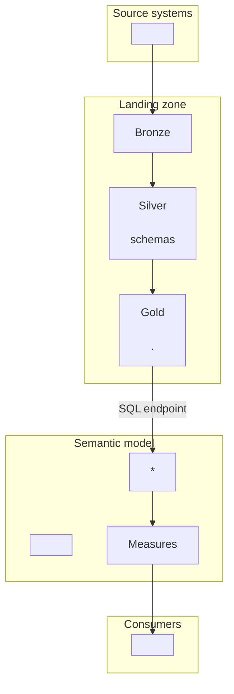

<!--
Group Analytics data product documentation template.
Used by the ga-data-product-documentation skill. Save the result in the project repository
as docs/<semantic model name>.md and review it in the same pull request as the model.

Rules for filling it in:
- Write from metadata only: PBIP (TMDL, PBIR), git, the Jira ticket and the review result.
  Never copy data values, people's data or screenshots with data into this document.
- Write "Not documented yet" instead of guessing. Mark open questions with "To confirm:".
- Keep the guidance comments out of the final document.
-->

# <Data product name>

| | |
|---|---|
| Semantic model | `<model name>` |
| Report(s) | `<report name>` |
| Status | Draft / In review / Released / Deprecated |
| Version | `<version or release date>` |
| Jira | `<GA-123>` |
| Repository | `<repository and folder>` |
| Report info | [Analytics Report Info](https://vitrolifeglobal.sharepoint.com/sites/GroupAnalytics-Infiles-PROD/Lists/Analytics%20%20Report%20Info/AllItems.aspx) <!-- or: "Manual _Report Info in the model" when the model keeps it as a DATATABLE --> |
| Last updated | `<YYYY-MM-DD>` by `<name>` |

> Draft prepared with AI assistance (Claude) from the project metadata. The owner reviews and approves it.

## Part 1 - For report users and owners

### Purpose

<!-- One paragraph: the business need and the decisions the data product supports. -->

### Business questions it answers

<!-- 3-6 bullets, phrased as questions users ask. -->

### Ownership and support

| Role | Name | Responsibility |
|---|---|---|
| Business owner | | Approves definitions and access |
| Data owner (source) | | Source data quality |
| Developer / maintainer | | Model and report changes |
| Support contact | | Questions and incidents |

<!-- Business contact data only (name, work email, role). -->

### Who can see what

<!-- Audience, how they get access (app, workspace role, Entra group) and the effect of row-level security in plain words. -->

### How to use the report

| Page | Purpose | Main filters |
|---|---|---|

### Key measures and definitions

| Measure | Business definition | Unit / currency | Notes |
|---|---|---|---|

### Data freshness

<!-- Refresh schedule, what "Refresh status" shows, expected delay from source to report. -->

### Warnings and things to consider (users)

<!-- Plain-language limitations users must know before acting on the numbers, for example:
- Amounts are in each company's own currency: do not add them up across companies.
- Values are blank unless exactly one company and one period are selected.
- The report is a validation tool, not the official financial report. -->

## Part 2 - Technical documentation

### Architecture and lineage

<!-- High-level lineage diagram (Mermaid; GitHub and tools/md_to_pdf.py draw it): source systems ->
landing zone and medallion layer (bronze, silver, gold: lakehouse and schema) -> model tables ->
measures (in groups) -> consumers (reports, Excel). One box per layer, not per column. Sources that
skip the medallion layers (SharePoint lists, Excel files) go straight to the model, with the edge
labelled "no medallion". Name lakehouses, schemas and objects exactly. Mark what is not known yet
with "(not documented yet)" instead of guessing. Draw it top to bottom (flowchart TB): left to right
gets too wide for an A4 page and the text becomes unreadable in the PDF. -->

| Model table | Power Query | Layer | Landing zone / workspace | Source object |
|---|---|---|---|---|

### Environments and parameters

| Parameter | Purpose | DEV | TEST / ACC | PRD |
|---|---|---|---|---|

<!-- Also: environment detection (_Environment), deployment path, workspace names. -->

### Semantic model

<!-- Storage mode, grain of each fact table, relationships (cardinality and direction), Calendar usage,
calculation groups, field parameters. -->

| Table | Type | Grain / content | Storage mode |
|---|---|---|---|

| From | To | Cardinality | Direction | Active |
|---|---|---|---|---|

### Measures (technical)

<!-- Group by display folder. For non-trivial measures: the logic in one sentence, filters it removes or changes,
and blank or error behaviour. -->

### Security

<!-- RLS roles, filter logic, where the access list is maintained, who maintains it, members (groups, not people),
and how it was tested (View as). Note that workspace Admins, Members and Contributors are not restricted by RLS. -->

### Data quality and validation

<!-- What was reconciled against what (for example the source system or the target system), when, by whom, result.
Known data quality issues and their owner. -->

### Best practice review

| Area | Result | Details |
|---|---|---|
| BPA rules (ga-model-review) | | |
| Release checklist (ga-release-checklist) | | |
| Documented exceptions | | |

### Warnings and things to consider (maintainers)

<!-- Technical risks and follow-ups, for example: hard-coded values, placeholder parameters for environments that
do not exist yet, dependencies on files or lists maintained by hand, single points of failure, performance risks,
standards that are not met and why, items to remove before production. -->

### Operations

<!-- Refresh schedule and gateway/connection, credentials (service account), monitoring, what to do when refresh fails. -->

### Change log

| Date | Version | Change | Jira | By |
|---|---|---|---|---|
