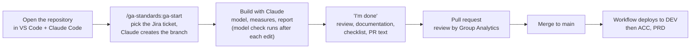

# Quick guide: working with Claude Code in this repository

## The flow

## What you type

| When | Type in Claude Code |
|---|---|
| Start or continue | `/ga-standards:ga-start` |
| Build | Describe the task, e.g. *"Add a sales measure with prior year"*, *"Add an Overview page"* |
| Independent review | *"Run the ga-reviewer agent"* |
| Where am I, what is missing? | *"Run the ga-workflow-reviewer agent"* |
| Finished | *"I'm done"* |

| When | Type in a terminal (repository folder) |
|---|---|
| The session start shows an ACTION line with commands | The commands exactly as shown, then open a new Claude Code tab |
| Check a model yourself | `python ../ga_analytics_standards/validators/validate_model.py .` (macOS: `python3`) |

**Mode.** At the start Claude asks which mode you want. *Ask before edits*: you approve every
change and command. *Edit automatically*: file changes in the repository happen without asking
(commands still ask); check `git diff` before you commit. Switch in the mode menu under the
prompt box. Auto and bypass are off.

Nothing is blocked by the checks: Claude proposes a fix or a documented exception, and the
pull request reviewer decides.

## Prerequisites

What you need installed, and the access to ask for:
[Prerequisites](https://vitrolife-group.ghe.com/group-analytics/ga_analytics_standards/blob/main/docs/getting-started.md#prerequisites)
in getting-started.md.

## Not allowed

Data files, Power BI and Fabric MCP servers, auto mode, changes to the shared repositories
and commits to `main`. The full list, with what to do instead:
[What is blocked](https://vitrolife-group.ghe.com/group-analytics/ga_analytics_standards/blob/main/docs/getting-started.md#what-is-blocked-and-why).

More detail (which skill when, what happens after merge):
[getting-started.md](https://vitrolife-group.ghe.com/group-analytics/ga_analytics_standards/blob/main/docs/getting-started.md).
